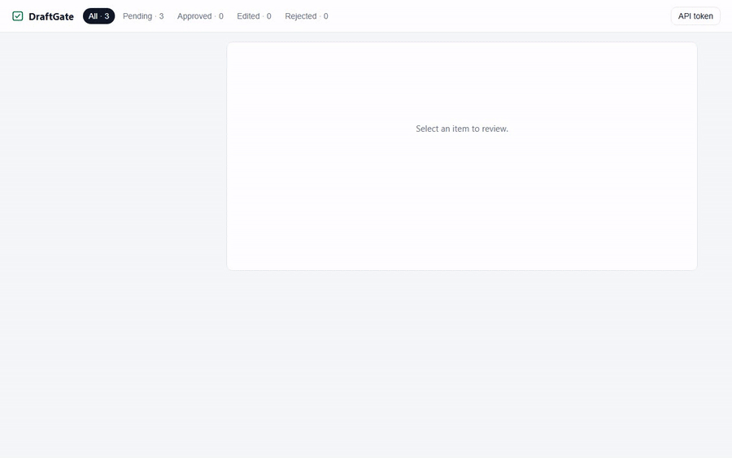

# DraftGate

> The human checkpoint for AI content pipelines.

[](LICENSE)
[](pyproject.toml)
[](README.zh-CN.md)



Your AI pipeline drafts the content. **You** decide what ships.

DraftGate is a tiny self-hosted review station for any AI workflow — n8n, Dify,
custom scripts, cron jobs. Content arrives in a review queue, a human clicks
**Approve / Reject / Edit & Approve** in the browser, and the decision goes back
to the pipeline via signed webhook or a blocking SDK call.

```
 your pipeline ──submit──►  DraftGate  ──webhook──► your pipeline
 (n8n / Dify / script)      human review             publish or discard
```

## Why

AI-generated content still needs a human glance before it goes out — a
newsletter, a social post, a report. Most teams solve this with a spreadsheet,
a chat channel, or nothing at all. DraftGate makes it a 5-minute integration:

- **Zero-config server** — SQLite storage, token auth, single binary-like pip package
- **Three decisions, with feedback** — approve, reject, or edit-then-approve; edits *and* an optional reviewer note (typical on reject) go back to the pipeline so it can revise instead of guessing
- **Signed webhooks** — HMAC-SHA256, automatic retries with backoff, manual retry button
- **Blocking SDK** — `gate.review(...)` parks your script until a human decides
- **CLI exit codes** — `0=approved 1=rejected 2=edited`, perfect for n8n / shell branching
- **Single-file web UI** — no Node build step, no JavaScript framework, polls quietly

## Quickstart

```bash
pip install git+https://github.com/buxiangcifan123/draftgate.git

draftgate serve                 # starts on http://127.0.0.1:8010
draftgate token                 # copy this token
```

Open [http://127.0.0.1:8010](http://127.0.0.1:8010), paste the token, and you have a review queue.

Submit your first draft:

```bash
export DRAFTGATE_TOKEN=$(draftgate token)
echo "Hello, human. Please review me." > draft.txt

draftgate submit --title "My first draft" --file draft.txt --timeout 600
echo "exit code: $?"    # 0=approved  1=rejected  2=edited
```

The command blocks until someone clicks a button in the browser, then exits
with a code your pipeline can branch on. The final item (including edited
content) is printed to stdout as JSON.

## SDK

```python
from draftgate import Client

gate = Client("http://127.0.0.1:8010", token="...")

result = gate.review(
    title="Weekly AI news digest",
    content=markdown_text,
    content_type="markdown",
    tags=["newsletter"],
    timeout=600,          # 0 = non-blocking
)

if result["status"] == "edited":
    publish(result["final_content"])   # human-fixed content
elif result["status"] == "approved":
    publish(result["content"])
```

## Webhooks

Submit items with a `callback_url` and DraftGate POSTs the decision back:

```json
{
  "item_id": 7,
  "action": "approve",
  "status": "approved",
  "title": "Weekly digest",
  "content": "final content (edited if action=edit)",
  "reason": "why the reviewer rejected it, or null",
  "tags": ["newsletter"],
  "metadata": {"any": "custom fields"},
  "decided_at": "2026-10-15 09:30:00"
}
```

Every request is signed. Verify it on your side:

```python
import hashlib, hmac

def is_valid(secret: str, raw_body: bytes, header: str) -> bool:
    expected = "sha256=" + hmac.new(secret.encode(), raw_body, hashlib.sha256).hexdigest()
    return hmac.compare_digest(header, expected)
```

Failed deliveries retry automatically (10s / 1m / 5m) and can be retried
manually from the UI. **Treat webhooks as at-least-once and key on `item_id`.**
Run `examples/mock_receiver.py` to watch deliveries arrive locally.

## REST API

Interactive docs at `/docs` once the server runs. Summary:

| Method | Path | Description |
|---|---|---|
| POST | `/api/items` | Submit a draft |
| GET | `/api/items?status=&limit=&offset=` | List items (pending first) |
| GET | `/api/items/{id}` | Item detail incl. `final_content` |
| POST | `/api/items/{id}/decision` | `{"action": "approve"\|"reject"\|"edit", "content": "...", "reason": "..."}` |
| POST | `/api/items/{id}/webhook/retry` | Re-send a failed webhook |
| GET | `/api/stats` | Counts per status |
| GET | `/health` | Liveness probe (no auth) |

Auth: `Authorization: Bearer <token>` (or `X-Draftgate-Token`). Items are
immutable once decided — decisions are final and idempotent.

`content` is required for `edit`; `reason` is optional for every action and is
echoed back in the webhook payload as `reason` (null when omitted). Use it to
tell an automated pipeline *why* a draft was rejected, so the retry has
something to act on.

## n8n integration

**Option A — Execute Command node** (simplest):

1. `draftgate submit --title "..." --file out.txt --timeout 900`
2. Branch on the node's exit code (`0` / `1` / `2`)
3. Parse stdout JSON for the final content

**Option B — HTTP Request node**: POST to `/api/items`, then poll
`GET /api/items/{id}` on a schedule until `status != "pending"`.

Remember to raise the node timeout — `submit --timeout` blocks by design.

## Configuration

| Env var | Default | Purpose |
|---|---|---|
| `DRAFTGATE_TOKEN` | generated on first run | API token |
| `DRAFTGATE_SECRET` | generated on first run | Default webhook signing secret |
| `DRAFTGATE_DB` | `~/.draftgate/draftgate.db` | SQLite file location |
| `DRAFTGATE_HOME` | `~/.draftgate` | Config directory |

Per-item `callback_secret` overrides the global secret.

## Security notes

- Binds to `127.0.0.1` by default; binding elsewhere is refused until you set an
  explicit `DRAFTGATE_TOKEN` (the auto-generated one from first run does not
  count — you would be exposing a server whose token you have never seen)
- CORS is restricted to localhost origins
- The UI stores the token in `localStorage` — fine for single-user local use,
  not for shared machines
- Webhook secrets are stored locally in SQLite; rotate by resubmitting items

## Development

```bash
git clone https://github.com/buxiangcifan123/draftgate.git
cd draftgate
python -m venv .venv && .venv/Scripts/pip install -e ".[dev]"   # Windows
# .venv/bin/pip install -e ".[dev]"                             # macOS / Linux

pytest                 # unit tests
python tests/e2e_demo.py   # full end-to-end: server + CLI + webhooks
```

## Roadmap

- [ ] PyPI package
- [ ] Long-polling wait endpoint (`GET /api/items/{id}/wait`)
- [ ] Docker image
- [ ] i18n UI
- [ ] Multiple reviewers / audit log

## License

[MIT](LICENSE)
